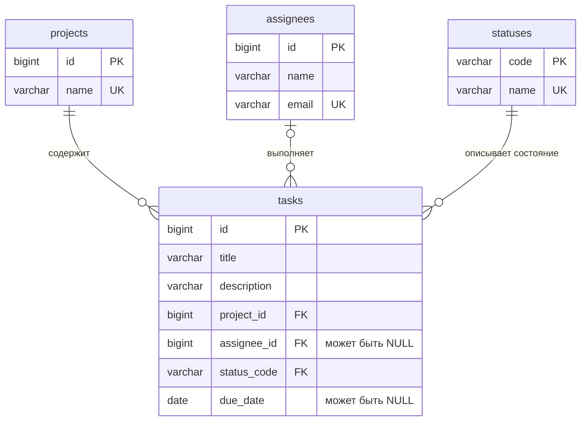
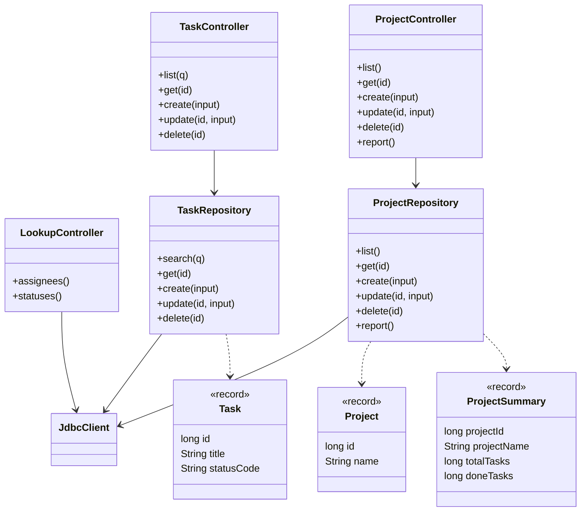

# Диаграммы проекта

Обе диаграммы также доступны для просмотра и печати в [отчёте PDF](report.pdf).

## Связи таблиц

Каждая задача принадлежит ровно одному проекту и имеет один статус. Ей можно назначить одного исполнителя. Каждый проект, исполнитель или статус может встречаться у любого числа задач.

## Классы приложения

На схеме показаны основные классы. Вложенные записи `Task.Input` и `Project.Input` задают входные поля. Общий обработчик `ApiErrors` формирует ответы при ошибках.
